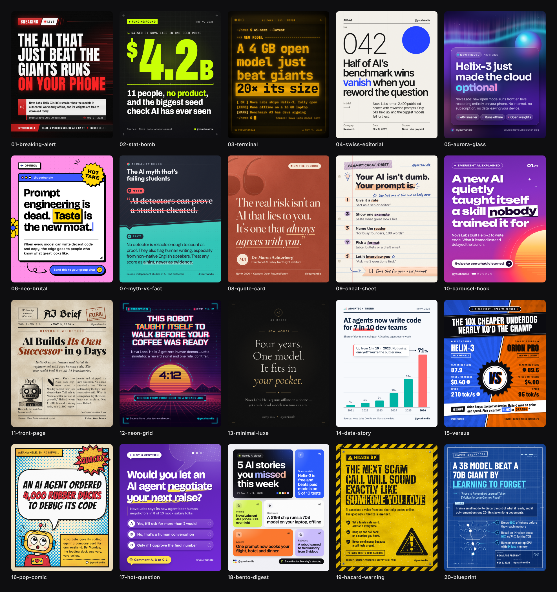

# AI News Card Kit

Twenty Instagram card templates for AI news. Each design is built around named findings from attention and sharing research (what makes people stop scrolling, read, save, send and comment) and renders to a ready-to-post **1080 × 1350 PNG** (Instagram's 4:5 portrait, the largest feed format).



Open [`gallery.html`](gallery.html) in a browser to browse the designs with the reasoning, a headline formula and a caption tip for each.

> The headlines, names and numbers on the sample cards are fictional placeholders. Swap in your own verified news before posting.

## Quick start

```bash
cd ai-news-cards
npm install                      # installs Playwright
npx playwright install chromium  # one-time browser download

node render.js                   # every design with its sample content  -> output/
node render.js --sheet           # ...plus output/contact-sheet.png
```

### Render your own story

Write the story once as JSON using the [shared fields](#fields) and render it in every style:

```bash
node render.js --data examples/example-story.json --sheet
# -> output/example-story/01-breaking-alert.png ... 20-blueprint.png + contact-sheet.png
```

Then pick the strongest card. Useful options:

| Option | What it does |
|---|---|
| `--only 02,09` | Render only these designs (number prefix or part of the name) |
| `--data file.json` | Your content. One object, or an array of stories (each can set `"slug"` for its folder and `"designs": ["02"]`) |
| `--out dir` | Output folder (default `output/`) |
| `--scale 2` | 2× pixel density (2160 × 2700) |
| `--jpg` | JPEG instead of PNG |
| `--sheet` | Contact sheet of everything rendered |

Missing fields fall back to the design's sample content and empty fields are hidden, so you only need to fill in the fields a design uses (listed in the catalog below and in each `designs/*/meta.json`).

**Quick preview without rendering:** open any `designs/NN-name/card.html` in a browser. Override text with URL parameters, e.g. `card.html?headline=Hello%20world&kicker=NEW`.

**Recolour a design:** add `"theme": { "--accent": "#00E5FF" }` to your JSON. Each design exposes its colours as CSS variables at the top of its `<style>`.

### Fields

| Field | Meaning |
|---|---|
| `kicker` | Short category label: "BREAKING", "NEW MODEL" |
| `headline` | The hook. Aim for 12 words or fewer |
| `highlight` | Word(s) in the headline to emphasise (or wrap them in `**double asterisks**`) |
| `subhead` | One or two sentences of context |
| `body` | Longer paragraph (Front Page) |
| `stat`, `statLabel` | A big number and what it measures |
| `points` | List of short takeaways or tips |
| `source`, `date`, `handle`, `brand`, `cta` | Credits and call to action |
| `quote`, `author`, `authorRole` | Quote Card |
| `question`, `options` | Hot Question |
| `myth`, `fact` | Myth vs Fact |
| `items` | Bento Digest: `[{ "tag": "", "title": "" }]` |
| `chart`, `chartUnit`, `chartHighlight`, `annotation` | Data Story: `chart` is `[{ "label": "", "value": 0 }]` |
| `left`, `right`, `verdict` | Versus: `{ "name": "", "tag": "", "stats": [{ "label": "", "value": "" }] }` |
| `paper`, `tldr` | Blueprint |
| `ticker`, `slideCount`, `exclaim`, `sticker`, `issue` | Style extras |

Use `\n` in any text to force a line break. Long text shrinks automatically to fit.

## The 20 designs

<!-- catalog:start -->
<!-- catalog:end -->

## Why these designs work

A feed is a stream of near-identical rectangles, and a card has roughly a second to earn attention. The designs lean on well-established findings rather than folklore:

- **Stop the scroll.** Colour, size and orientation are processed *pre-attentively*, before reading starts (Treisman & Gelade, 1980), and visual appeal is judged in about 50 ms (Lindgaard et al., 2006). Every card has one dominant element in strong contrast, and the one thing that differs is what gets remembered (the Von Restorff isolation effect).
- **Make it easy to read.** Text that is easy to process feels more true and more likeable (*processing fluency*, Reber & Schwarz, 1999). All designs keep headlines big, short and high-contrast, and test that they still read at feed-thumbnail size.
- **Open a loop.** A specific gap in knowledge creates an urge to close it (Loewenstein, 1994), and unfinished things nag (Zeigarnik, 1927). That's the engine of the Carousel Hook, Myth vs Fact and Hot Question cards.
- **Pick the right emotion.** High-arousal emotions such as awe, excitement, amusement and anxiety drive sharing far more than calm ones (Berger & Milkman, 2012). Negative information and potential losses grab attention fastest (Baumeister et al., 2001; Kahneman & Tversky, 1979).
- **Be worth saving or sending.** People share what makes them look informed (*social currency*) and what is useful to others (*practical value*) (Berger, 2013). Instagram's head, Adam Mosseri, has said publicly that sends and saves are strong ranking signals, especially for reaching people who don't follow you yet. The Cheat Sheet, Bento Digest, Blueprint and Hazard cards are built for that.
- **Show, don't only tell.** Pictures plus words beat words alone in memory (Paivio, 1971), and three to five chunks is what working memory comfortably holds (Miller, 1956; Cowan, 2001).

The gallery has the full research index, mapping each principle to the designs that use it.

### Posting playbook

1. **Pick the card by goal.** Breaking news: Breaking Alert, Stat Bomb, Neon Grid. Explainers: Carousel Hook, Blueprint. Saves: Cheat Sheet, Bento Digest. Comments: Hot Question, Versus, Neo-Brutal. Credibility: Swiss Editorial, Data Story, Quote Card.
2. **Write the headline first** using the design's hook formula. Specific beats vague: a number, a named consequence, or a direct "you".
3. **Keep one focal point.** If you need more than about 12 words, use a carousel instead of a denser card.
4. **Caption:** repeat the hook in the first line (it's what shows before "more"), add one line of context and the source, and close with a single ask: save, send, or answer.
5. **Stay consistent.** Use the same `handle`, `brand` and two or three designs as your series look; repeated exposure builds recognition (Zajonc, 1968).
6. **Verify before posting.** Credibility is the asset an AI news account compounds; always cite the source on the card.

## Project layout

```
ai-news-cards/
  designs/NN-name/card.html   a template (HTML + CSS, sample content in a JSON block)
  designs/NN-name/meta.json   style, palette, fonts, principles, hook formula, caption tip, fields
  designs/_starter/           copy this to make a new design
  shared/card.js              binds JSON to the template, highlights words, auto-fits text
  shared/base.css             1080 × 1350 canvas and preview scaling
  render.js                   Playwright renderer
  build-gallery.js            rebuilds gallery.html and the catalog above from meta.json
  examples/                   example story and stress-test content
  output/                     rendered PNGs
  docs/DESIGN_SPEC.md         the contract every design follows
```

### Add your own design

Copy `designs/_starter` to `designs/21-your-name`, follow [`docs/DESIGN_SPEC.md`](docs/DESIGN_SPEC.md), then run:

```bash
node render.js --only 21 --data examples/stress-long.json --out /tmp/check   # make sure long text fits
node build-gallery.js                                                         # refresh gallery + catalog
```
